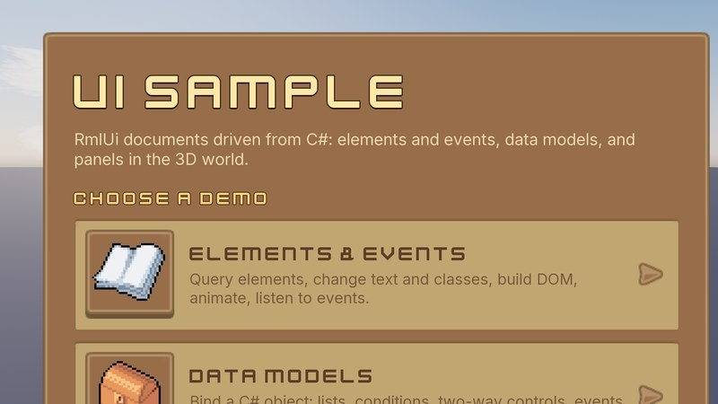
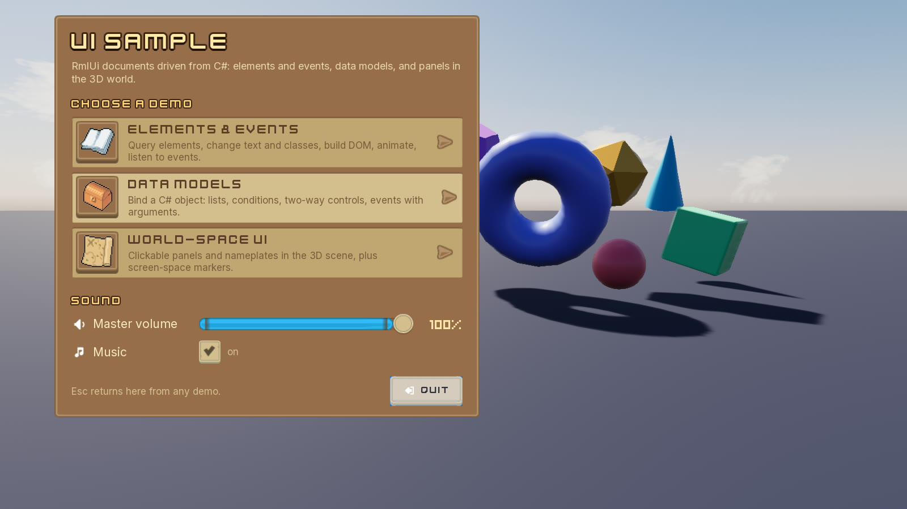
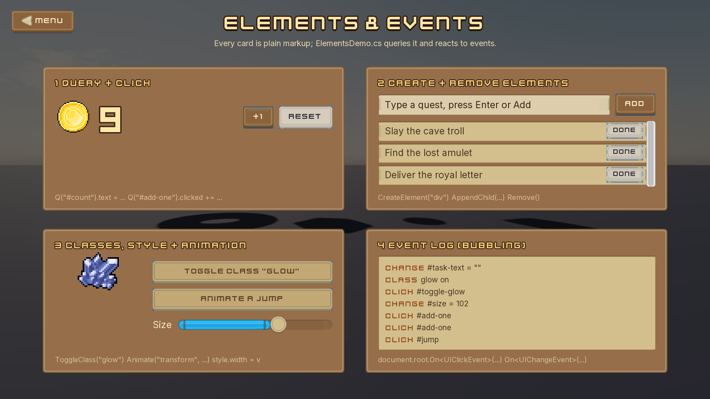
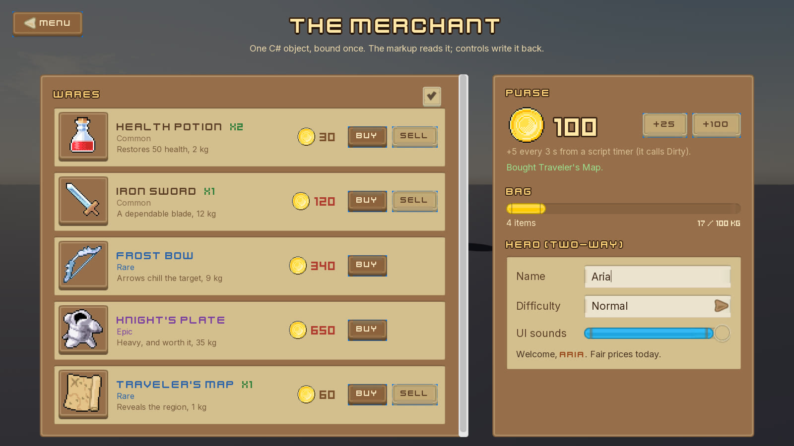
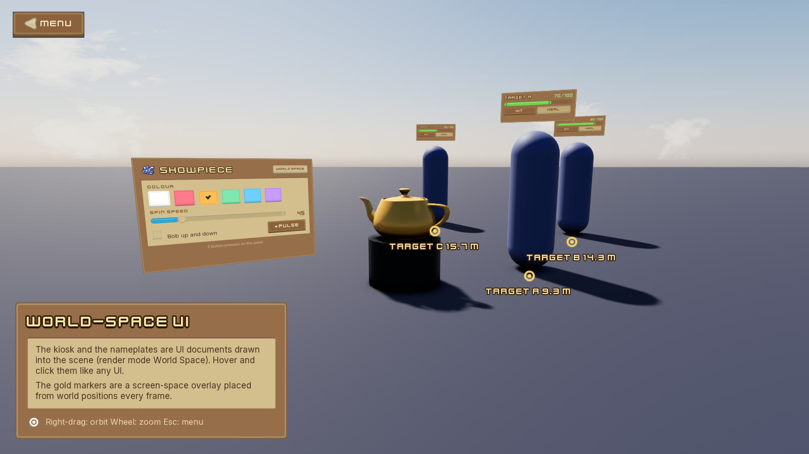
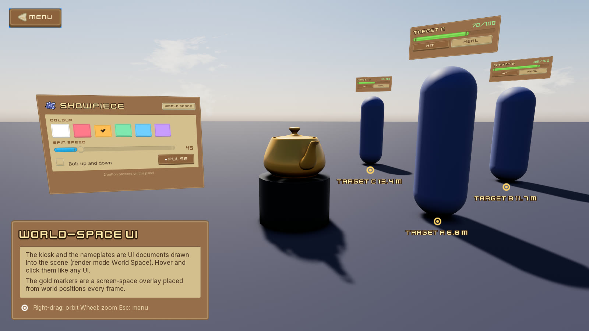

# Game UI

A main menu and three scenes of game UI in an RPG skin: every element and control, data models bound to C# scripts,
and UI placed in the 3D world. Everything is RmlUi documents and style sheets driven by C# scripts. A sample project
for [Unravel Engine](https://github.com/unravel-dev/UnravelEngine).

## Play

Clone this repository, or get it from the Samples page of the Unravel editor's start page, and open its folder in
the editor. Open `data/Scenes/MainMenu.spfb` and press Play; it is also the startup scene of a deployed build. The
menu's cards open the three demo scenes, and each demo's Menu button leads back.

| Action | Keyboard and mouse | Gamepad | Touch |
|---|---|---|---|
| Use the UI: buttons, sliders, checkboxes, fields | Mouse | - | Tap |
| Back to the menu | Esc, Menu button | - | Menu button |
| Add a quest (Elements and Events) | Type, Enter or Add | - | Add button |
| Orbit the camera, zoom (World-Space UI) | Right-drag, wheel | - | - |

The UI has no gamepad navigation. Taps reach every element, panels in the world included; orbit and zoom need a
mouse. Out of play mode nothing is bound, so the editor shows the documents' raw `{{ }}` templates.

## What it shows

### Main menu

The data model `menu` (`MainMenuController.cs`, `UI/Menu/main_menu.rhtml`): cards from a `data-for` list with
`data-event-click="Open(i)"` and a hover sound, a two-way master volume slider whose label goes through a C#
transform (`{{ masterVolume | percent }}`), a Music checkbox that fades the music bus, and a sprite picked by an
expression (`data-attr-sprite`). Shapes spin behind the menu (`Spinner.cs`).

### 1. Elements and Events

No data model: `ElementsDemo.cs` drives `UI/Elements/elements_demo.rhtml` through the element API, card by card.

- **Query and click**: `Q("#id")`, `.text` and `.clicked`, a counter with a `pop` `@keyframes` animation.
- **Create and remove elements**: `CreateElement`, `AppendChild` and `Remove`, a quest list built from a text field
  with a keydown listener.
- **Classes, style and animation**: `ToggleClass("glow")` swaps a coin for a crystal, `Animate()` chains two tweens,
  a slider sets `style.width` and `style["image-color"]`.
- **Event log**: listeners on the document root receive bubbled click and change events.

The script sets itself up again in `documentLoaded`, so editing the document reloads it in play.

### 2. Data Models: The Merchant

The data model `shop` (`ShopController.cs`, `UI/DataModels/shop.rhtml`), bound once with `model.Bind`: `data-for`,
`data-if`, `data-visible`, `data-class-*`, `data-attr-value` on a progress bar, and `data-event-click` with an index or
a literal argument (`Buy(i)`, `Sell(i)`, `Earn(25)`). Two-way controls: a checkbox, a text field, a select whose
setter re-prices the wares, and a UI volume slider on the UI bus. Computed read-only properties, enums read as names,
a `gold` transform with N0 formatting, and an income timer that shows why `Dirty` is needed.

### 3. World-Space UI

- **Kiosk panel** (`KioskPanel.cs`, `UI/WorldSpace/kiosk.rhtml`): a document rendered in the world, 2.56 m wide.
  Colour swatches set a per-renderer material instance on the showpiece, a slider and a checkbox spin and bob it,
  Pulse plays a spatial coin sound.
- **Nameplates** (`Nameplate.cs`, `UI/WorldSpace/nameplate.rhtml`): one world document per target, with Hit and Heal
  buttons and a health bar, turned to face the camera.
- **Markers** (`WorldMarkers.cs`, `UI/WorldSpace/world_hud.rhtml`): a screen-space HUD that places one marker per
  target with `WorldToScreenPoint` and shows its distance.

`UISounds.cs` plays the one-shot UI sounds of every scene on the UI bus.

## Screenshots

| | |
|---|---|
|  |  |
|  |  |
|  | |

## Project layout

| Path | What it holds |
|---|---|
| `data/Scenes/` | `MainMenu`, `01_Elements`, `02_DataModels` and `03_WorldSpace`. |
| `data/Scripts/Menu/MainMenuController.cs` | The menu and its settings model. |
| `data/Scripts/Elements/ElementsDemo.cs` | The element API demo. |
| `data/Scripts/DataModels/ShopController.cs` | The shop's data model. |
| `data/Scripts/WorldSpace/` | `KioskPanel`, `Nameplate`, `WorldMarkers`, and `OrbitCamera` (right-drag orbit, wheel zoom). |
| `data/Scripts/Common/` | `MenuNavigation` (back to the menu), `Spinner` (spin, bob, pulse), `UISounds`. |
| `data/UI/Shared/` | `theme.rcss` (the RPG skin: ninepatch, tiled and image decorators, fonts, the small-screen rules), `atlas.rcss` and `ui_atlas.png`. |
| `data/UI/Menu/`, `Elements/`, `DataModels/`, `WorldSpace/` | Each page's documents and style sheets. |
| `data/Audio/`, `data/Fonts/`, `data/Materials/` | Sounds, the two pixel fonts, the scenes' materials. |
| `data/Licenses/` | The credits and the asset licenses. |

## Platforms

| Profile | Notes |
|---|---|
| Desktop | Windows or Linux, as the editor runs on. |

The style sheets are in `dp` with media queries for small screens, so the Game panel's phone and tablet presets
show the layouts a phone would get.

Deploy from the editor's Deploy window with a profile from `profiles/`.

## Credits

All third-party art is CC0 1.0 (public domain); `data/Licenses/CREDITS.txt` lists it with its license files.

| Asset | Author | License | Source |
|---|---|---|---|
| UI Pack (RPG Expansion): panels, buttons, bars, icons, arrows | Kenney | CC0 1.0 | https://kenney.nl |
| Game Icons | Kenney | CC0 1.0 | https://kenney.nl |
| Kenney Future and Kenney Mini Square fonts | Kenney | CC0 1.0 | https://kenney.nl |
| 496 pixel art icons for medieval/fantasy RPG | Henrique Lazarini (7Soul1) | CC0 1.0 | https://opengameart.org |

The sounds were generated for this sample, and the body text uses the Inter typeface that ships with the engine.
Code and all other content are under the MIT license in [LICENSE](LICENSE).
